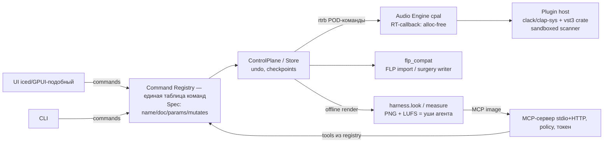

# OSS_AUDIT — аудит open-source проектов для VibeStudio

**Дата проверки:** 2026-10-20. **Метод:** чтение исходников (shallow-клоны в `/tmp/oss_audit`, только чтение — ничего не устанавливалось, не собиралось и не запускалось), GitHub API (`gh`), crates.io API, PyPI, веб-проверка сайтов. Все факты взяты из кода и метаданных, а не из README-обещаний; в детальных заметках каждый факт помечен `[ПОДТВЕРЖДЕНО]`/`[ПРЕДПОЛОЖЕНИЕ]` со ссылкой на исходник.

**Детальные заметки (10 файлов):** [`docs/research/`](docs/research/) — `flpdiff.md`, `flpkit.md`, `pyflp.md`, `vibez.md`, `maolan.md`, `tripplyons-daw.md`, `ryolune.md`, `aura-daw.md`, `simply-nexus.md`, `mcp-audio-landscape.md`.

> Этот документ — вход для `ROADMAP.md` (в папке проекта его ещё нет; раздел 10 содержит готовую дельту изменений для него). Ничего в существующих файлах не менялось.

---

## 1. Executive summary

1. **Ни один изученный проект не годится как база или форк для VibeStudio.** Каждый закрывается лицензией (vibez, aura-daw, PyFLP — GPL-3.0), платформой (nexus-app и aura-daw — фактически Linux/macOS-only, без Windows), зрелостью (tripplyons/daw — 3 недели, nexus — прототип) или архитектурой (maolan — 8 репозиториев + tokio; ryolune — жёсткая зависимость от GPUI/Zed).
2. **Зато подтверждён весь целевой стек VibeStudio.** Четыре независимых проекта на Rust используют одну и ту же связку: `cpal` + `rtrb` + `iced`/GPUI + `clap-sys`/`clack` + `vst3` crate + `midir`. Это снимает главный технический риск «работает ли Rust-стек для DAW» — работает, де-факто стандарт ниши.
3. **FLP-стек решён архитектурно, но требует собственной реализации.** Готового безопасного писателя нет: PyFLP (самый полный парсер) — GPL и заморожен с 2023, сломан на FL 2024+; flpdiff (MIT) даёт лучшую в open source спецификацию формата и мутации только для FL 25; flpkit (MIT) даёт методологию безопасной записи (raw-surgery + verify-by-readback), но покрывает узкий набор полей. Вывод: собственный Rust-парсер по MIT-спеке flpdiff + методология flpkit + оба инструмента как тестовые оракулы в CI.
4. **MCP-управление DAW — доказанная ниша с готовыми паттернами.** Спрос подтверждён (ableton-mcp — 3211★), а правильная архитектура уже изобретена: единый command registry, из которого генерируются UI, CLI и MCP-инструменты (ryolune: 245 tools из одной таблицы команд), плюс policy-слой и аутентификация (aura-daw), плюс offline-рендер как «уши» агента (nexus). Всё MIT — паттерны и код можно брать.
5. **Рекомендуемая стратегия — гибрид «с нуля + заимствование компонентов»** (подробно в разделах 6–7): собственная модель проекта, движок и UI; заимствование MIT/BSD-компонентов (AU-хостинг, garbage-очередь, тройной буфер) и архитектурных паттернов (registry, ControlPlane, allocation-тесты); GPL-проекты — только как учебники (читать можно, копировать нельзя).

---

## 2. Сводная таблица всех проектов

| Проект | Что это | Язык | Лицензия | Активность (последний коммит) | Зрелость | Вердикт для VibeStudio |
|---|---|---|---|---|---|---|
| [flpdiff](https://github.com/dawhubapp/flpdiff) | Парсер + diff + writer + спецификация FLP | TypeScript/Bun | **MIT** | 2026-07-04 на main (спит), релиз v0.1.2 | Самый зрелый FLP-стек OSS: 490 тестов, FL 9–25 чтение | Спека — справочник; CLI — CI-оракул; код — референс алгоритмов |
| [flpkit](https://github.com/clarkipeng/flpkit) | Чтение/точечная запись FLP | Python, zero-dep | **MIT** | 2026-09-07 (PyPI 0.8.1) | Узкий скоуп, но верифицирован живым FL 2026 | Методология writer'а (surgery + readback) — образец |
| [PyFLP](https://github.com/demberto/PyFLP) | Парсер FLP (самый полный) | Python | **GPL-3.0** | Заморожен ~с 2023 (PyPI 2.2.1) | 220★, но FL 2024+ не читает (issues #208/#205/#200) | Код не трогать; чёрный ящик-оракул на старых файлах (FL ≤ 21) |
| [vibez](https://github.com/alexanderwanyoike/vibez) | Полноценная DAW на Rust | Rust | **GPL-3.0** | 2026-10-19, v0.5.1, 863 коммита за октябрь | Лидер ниши: ~254k LOC, 2451 тест, 0 заглушек | Только идеи/архитектура (GPL); лучший учебник по Rust-DAW |
| [maolan](https://github.com/maolan/maolan) | Экосистема DAW (8 репо) | Rust | **BSD-2** | 2026-10-17, ежедневная работа | 6 лет истории; движок — крейт на crates.io | Донор компонентов (BSD): OOP-плагины, triple buffer, backends |
| [tripplyons/daw](https://github.com/tripplyons/daw) | FL-подобная DAW на iced | Rust | **MIT** | 2026-10-09 (3 недели проекту) | 22.8k LOC, 174 теста, нет Windows и CI | Донор компонентов: AU-хостинг, garbage-очередь, CLI+AI-skill |
| [ryolune](https://github.com/ludovic111/ryolune) | AI-native DAW (GPUI) | Rust | **MIT** | 2026-10-12, v0.17.0, 17 релизов/месяц | Настоящая бета: 593 теста + 13 AI-evals, подписанные macOS-сборки | Эталон MCP-слоя (245 tools из registry); донор паттернов и кода |
| [aura-daw](https://github.com/knobo/aura-daw) | AI-native DAW (Tauri) | Rust | **GPL-3.0** | **Остановился 2026-09-02** | Честный vertical slice, Linux-only | Код нельзя (GPL); взять паттерны security/policy MCP |
| [nexus](https://github.com/poucet/nexus) (simply-music.ai) | Rust-хост VST3/CLAP + headless MCP | Rust | **MIT** | **Спит с 2026-09-04**, v0.3.0 | Качественный прототип, 86 коммитов, без crates.io | Референс слоистой архитектуры engine→tools→MCP; не зависимость |

Общий паттерн риска: **все 9 проектов — single-maintainer** (bus factor = 1 у каждого), поэтому ничто из них нельзя брать как обязательную runtime-зависимость — только как вендоримый код, референс или внешний CI-оракул.

---

## 3. FLP-инструменты (reverse engineering формата)

### 3.1 Сравнение

| Критерий | flpdiff | flpkit | PyFLP |
|---|---|---|---|
| Лицензия | MIT ([LICENSE](https://github.com/dawhubapp/flpdiff/blob/main/LICENSE)) | MIT ([LICENSE](https://github.com/clarkipeng/flpkit/blob/main/LICENSE)) | **GPL-3.0** ([LICENSE](https://github.com/demberto/PyFLP/blob/master/LICENSE)) |
| Код в VibeStudio | Можно (с NOTICE) | Можно (с NOTICE) | **Запрещено** |
| Оракул в CI | Да — CLI, exit-коды 0/1/2 | Ограниченно (мало покрывает) | Да — чёрный ящик, но только FL ≤ 21 |
| Версии FL: чтение | **FL 9–25** (parity-свип 85/85) | «era-opaque» + stride-детекция (FL 2026) | FL ≤ 21; **FL 2024+ сломан** |
| Версии FL: запись | Мутации **только FL 25** | FL 2026, узкий набор полей | Практически опасен (полный ресериализм) |
| Стратегия записи | Полный рерайт + round-trip guarantee | **Raw byte surgery + verify-by-readback** | Полный ресериализм (FL отказывается открывать — сообщение flpkit) |
| Plugin state | VST-wrapper (0xD5) декодирует name/vendor/path; state остаётся opaque | Opaque, хэш-валидация ссылок | VST-wrapper поля частично каталогизированы |
| Mixer graph | Да (inserts, слоты, routing) | Нет | Да (inserts, слоты, routing) |
| Automation | Чтение ключевых кадров; запись — non-goal | Точки в существующем клипе | Контроллеры; полных envelope-моделей нет (issue #29) |
| Тесты/fixtures | 490 тестов; 5 публичных FL25-фикстур; личный корпус (85 файлов) gitignored | 97 unit + 21 golden; live-FL round-trip | Per-model тесты + коммитнутые .flp фикстуры |
| Спецификация формата | **Да: [flp-format-spec.md](https://github.com/dawhubapp/flpdiff/blob/main/docs/fl-format/flp-format-spec.md), 517 строк, ~40 opcode'ов с уровнями доверия** | Нет (знание в коде) | Docs, но уровень 2023 года |
| Активность | Спит с 07.2026; один автор | 2 недели жизни (08–09.2026) | Заморожен с 2023 |
| Главный риск | 0.1.x API; org держит GPL-форк PyFLP рядом | 1★, нет CI, приватный харнес | GPL + устарел + writer опасен |

### 3.2 Перекрёстная сверка фактов формата (важно для собственного парсера)

Три независимые реализации расходятся в деталях — это карта ловушек для VibeStudio:

| Факт | flpdiff | flpkit | PyFLP | Рабочая гипотеза VibeStudio |
|---|---|---|---|---|
| Payload события 172 (`0xAC`) | **3 байта** (spec §2.2, issue #1) | 1 байт (fallback-таблица) | **3 байта** (issue #208, hex `01 01 00`) | **3 байта** (2 источника + hex-dump); проверять minimal-pair экспериментом на живом FL |
| Playlist clip record | 80 B (FL 25) / 60 B (FL 21–24) / 32 B (раньше) | **Детекция по сигнатуре**: 32/60/80/**88 B** | 32/60 известны; 80 B — открытый #205 | **Detect-don't-assume** (подход flpkit), а не таблица версий |
| FL25-релокации opcode'ов | notes 0xD0→0xE0, Levels 0xCB→0xDB, track 0xDE→0xEE, flags 0xDC→0xEC | Совпадает | Не поддерживает FL 25 | Консистентно, принимать как факт |
| Запись файлов | Полный рерайт + byte-exact round-trip | Только сплайс, никогда не ресериализует | Полный рерайт | **Surgery-first** (flpkit-модель) как самая верифицируемая |

### 3.3 Выводы

- **Спецификация flpdiff — главный актив.** Clean-room-декларация в самой спеке + MIT; единственная оговорка — организация `dawhubapp` параллельно держит GPL-форк PyFLP, поэтому при копировании любых файлов из flpdiff проверять LICENSE каждого файла и вести NOTICE.
- **Свой FLP-писатель строить по модели flpkit**: locate → encode → splice → bump `FLdt.length` → перечитать файл → verify-identical, иначе отказ. Неизвестные байты выживают by construction. Полный ресериализм (путь PyFLP) — задокументированный анти-паттерн.
- **Корпус фикстур — своя ответственность.** Публичных файлов мало (5 у flpdiff), личные корпуса у всех gitignored («never commit real user projects»). VibeStudio нужен собственный корпус на законных основаниях (свои проекты) + опционально публичные фикстуры flpdiff для FL 25.
- Уровневая модель поддержки из брифа (чтение → notes → playlist → automation → mixer → plugin state → writer) подтверждается: автоматизация (PAHDSR, #29) и нативные plugin states — самые большие белые пятна во всех трёх проектах.

---

## 4. DAW на Rust

### 4.1 Сравнительная таблица

| Критерий | vibez | maolan | tripplyons/daw |
|---|---|---|---|
| Лицензия | **GPL-3.0-or-later** (+ ASIO SDK под GPL-опцией) | **BSD-2** (все 8 репо) | **MIT** |
| Возраст / активность | 8 мес, разгоняется (v0.5.1, 863 коммита в октябре) | 6 лет, ежедневная работа | 3 недели, затем пауза с 10.2026 |
| Масштаб | ~254k LOC, 2451 тестов, 0 `todo!` | app 95k + engine 81k + plugin-host 20k LOC; 1113 тестов | 22.8k LOC, 174 теста, 0 `todo!` |
| CI / релизы | 3 ОС в CI + релизы (deb/AppImage/dmg/Windows) | CI 3 ОС; теги 0.4.x | **Нет CI, нет релизов** |
| UI | iced 0.13, Elm-домены | iced через собственный `maolan-widgets` | iced 0.14, тайлинг i3-стиля |
| Аудио I/O | cpal 0.16 (WASAPI+ASIO/CoreAudio/ALSA) | Собственные workers: ALSA/JACK/CoreAudio/WASAPI/**ASIO**/OSS/sndio | cpal 0.18 (без Windows) |
| Plugin hosting | VST3 (`vst3` 0.3) + CLAP (`clap-sys` 0.5), native GUI, sandboxed-сканер | **Out-of-process** (процесс на плагин, shm-IPC, watchdog): CLAP/VST3/LV2 + AU | VST3 + **AU через `AUAudioUnit` (objc2)**, sandboxed-сканер, native GUI |
| FL-подобность | Clip launcher (Perform) + Arrange — ближе к Ableton-гибриду | Традиционная линейная | **Ближе всех к FL**: patterns/playlist/channel rack/piano roll/automation |
| RT-safety | **Доказывается тестами**: exhaustive allocation-free таблица для каждого EngineCommand | basedrop, triple buffer, arc-swap, plan-рендер | Event-буферы фиксированной ёмкости, **garbage-очередь** для RT-деаллокации |
| Offline render / экспорт | Bounce Master/Track/Clip тем же кодом, что live | Bounce + WAV/FLAC, dither/normalize | WAV + **stems**, фоновая отмена, consolidate |
| AI-friendliness | Документация (ARCHITECTURE.md 761 строка) | AGENTS.md для агентов | **CLI + готовый `.claude/skills/daw-project`** |
| Как форк | Нет (GPL; проприетарный продукт «заразится») | Технически можно, но 8 репо + tokio-рантайм | Технически можно, но нет Windows/CI, слишком юн |

### 4.2 Выводы

- **Ниша «Rust-DAW» реальна и активна**: три независимых проекта, три разных подхода, все живы (maolan — 6-й год). Целевой стек VibeStudio совпадает со стеком всех трёх — риск «не взлетит технологически» снят.
- **vibez — архитектурный учебник №1** (GPL — только читать): exhaustive allocation-тесты команд, два clock domain (Perform/Arrange), PDC как отдельная подсистема, offline-рендер тем же кодом, что live, sandboxed plugin scanner.
- **maolan — донор компонентов №1** (BSD-2): out-of-process plugin hosting (процесс на плагин, shm-IPC, spin-бюджет 2 мс, watchdog) — готовый чертёж crash-isolation; triple_buffer; поддержка backends отдельными worker-модулями; движок как отдельный крейт с `default = []` фичами.
- **tripplyons/daw — референс «FL-подобности» №1** (MIT): FL-терминология и панели, компактный AU-хост (695 строк на objc2), garbage-очередь, CLI как «второй вход» в DAW для агентов и тестов.
- Совпадение выводов независимо: все три делают plugin scanning в отдельном процессе, все — event/command очереди через rtrb, все держат UI вне аудиопотока. Это конвергентное подтверждение архитектуры из брифа.

---

## 5. AI-native DAW и MCP

### 5.1 Сравнение трёх MCP-реализаций

| Критерий | ryolune | aura-daw | nexus (poucet) |
|---|---|---|---|
| Лицензия | **MIT** | GPL-3.0 | **MIT** |
| Состояние | Живой, v0.17.0, 17 релизов/мес | **Остановился 09.2026** | **Спит с 09.2026** |
| MCP SDK | Свой JSON-RPC 2.0 over stdio (636 строк, без SDK) | **rmcp 3.1** (официальный) | **rmcp 0.9.1** (официальный) |
| Транспорт | stdio (live через TCP+token к запущенному app; headless с автосохранением и файловым локом) | streamable HTTP `127.0.0.1:41717/mcp` | stdio + streamable HTTP `:9997/mcp` |
| Число tools | **245 — сгенерированы из единого command registry** | 10 frozen (state/mix/transport/record/import/AI-jobs) | 13 (plugins/presets/params/**render_audio**/state decode-edit-diff-snapshot) |
| Покрытие | Вся DAW: клипы, ноты, automation, plugins, export, screenshot | Нет нот/клипов/automation — узко | Уровень plugin-host, не DAW |
| Безопасность | Авто-checkpoint перед первой правкой + revert; «finish routine» (агент обязан look/measure перед отчётом) | **Лучшая модель**: per-launch 256-bit токен (0600), constant-time compare, Origin-защита, policy readOnly/confirmDestructive/full + per-tool overrides, UI-confirm 60 с ⇒ deny | Readback-верификация state-операций |
| RT-safety | Команды AI — через store на interface thread, в audio callback только rtrb | ControlPlane — единая дверь UI и MCP; SPSC-кольца в callback; read_meters без блокировки | Движок без device I/O; clear/ack handshake при teardown плагина |
| «Уши» агента | `harness.look` (офлайн-рендер песни в PNG: волна+LUFS+спектр+piano roll), `ui.screenshot` | `read_meters` (60 Hz peak/RMS) | `render_audio` → WAV 48 kHz + peak/rms/silence метрики |
| Регресс AI-качества | **13 AI-evals с автоскорингом песни** (темп, тональность, LUFS, «не тронул треки человека») | Интеграционные тесты confirm/auth | Тесты MCP-протокола |
| Урок для VibeStudio | **Registry → все клиенты** (UI/CLI/MCP/встроенный агент — одно undo) | Policy/auth-чеклист | Слоистость engine→tools→MCP; offline-рендер как инструмент агента |

### 5.2 Ландшафт (детали в [mcp-audio-landscape.md](docs/research/mcp-audio-landscape.md))

- Спрос доказан: ableton-mcp — 3211★ за ~1.5 года; fl-studio-mcp — 228★ (через MIDI-хаки, потому что у FL нет API); минимум 6 REAPER-серверов.
- Но **все мосты — костыли над чужими DAW**: ни один не может дать агенту offline-рендер с метриками, diff состояния плагина и синхронность с транспортом. Это может только нативный движок — главное позиционирование VibeStudio.
- Сложившиеся ожидания рынка: оба транспорта (stdio + localhost HTTP), readback-верификация после каждого действия, fail-closed, ~20–30 содержательных tools на старте (не 200, как у REAPER-серверов, и не 10, как у AURA).

---

## 6. Сравнение трёх стратегий

| Критерий | 1. С нуля | 2. Готовый движок/компоненты | 3. Форк DAW |
|---|---|---|---|
| Кандидат-носитель | — | `maolan-engine` (BSD-2, crates.io), `nexus-host` (MIT, нет на crates.io), крейты clack/clap-sys/vst3 | MIT: tripplyons/daw, ryolune, nexus. GPL-варианты (vibez, aura) отпадают для проприетарного продукта |
| Контроль над архитектурой | Полный | Частичный (чужие релизы, tokio у maolan) | Чужая архитектура: GPUI (ryolune), 8 репо (maolan), webview (aura — отпадает по GPL) |
| FL-подобный workflow | Строим сами по референсам | Нет ни у одного движка | tripplyons — да, но 3 недели и нет Windows; ryolune — да, но GPUI |
| Кроссплатформенность (macOS/Win/Linux) | С первого дня (как в брифе) | maolan: да, но Windows-ASIO свежий; nexus-app: только macOS | Ни один форк-кандидат не имеет работающей Windows-сборки сегодня |
| MCP/AI-слой | Проектируем сразу (registry-first) | Придётся пристраивать к чужому API | У ryolune — лучший, но вплетён в их GPUI-стек |
| Скорость до первого звука | Средняя (стек подтверждён практикой 4 проектов) | Быстрая, но связывает с чужим рантаймом | Быстрая, но потом годы распутывания чужого |
| Лицензионная чистота | Полная | BSD-2 — чисто с атрибуцией | Зависит от кандидата; у лучших по функциям (vibez) — GPL-стена |
| Долгосрочная стоимость | Высокая upfront, низкая потом | Низкая upfront, средняя потом (чужие breaking changes) | Кажется низкой, фактически высокой (bus factor = 1 у всех кандидатов) |
| **Вердикт** | **Базовая стратегия** | **Как тактика внутри стратегии 1** | **Отклонить** |

**Разбор:**

1. **Форк отклоняется.** Ни один MIT-кандидат не удовлетворяет минимальным требованиям брифа (три ОС + FL-workflow + собственный движок): tripplyons/daw — нет Windows/CI, 3 недели жизни; ryolune — Windows не готов, жёсткая зависимость от GPUI (фреймворк Zed, самохостед CI автора), CLA; nexus — это хост, а не DAW. GPL-кандидаты (vibez, aura-daw) делают форк синонимом «VibeStudio становится GPL-3.0» — это решение можно принять только осознанно, и оно не вытекает из брифа.
2. **«Готовый движок» как зависимость отклоняется, «готовые компоненты» — принимается.** `maolan-engine` технически берётся с crates.io под BSD-2, но тянет tokio-центричный рантайм и чужой релизный цикл — против принципа «собственный движок, UI отдельно». Зато нижележащие крейты (`cpal`, `rtrb`, `clack`/`clap-sys`, `vst3`, `midir`, `symphonia`, `hound`) — проверены четырьмя проектами одновременно и берутся как раз те самые «архитектурные компоненты». Плюс точечное заимствование кода из MIT/BSD-репозиториев (см. раздел 7).
3. **С нуля — подтверждается**, но не «в пустоте», а с конвергентно подтверждённым стеком и набором референсных реализаций каждой подсистемы. Один человек + AI-агенты при таком раскладе не изобретает — собирает из проверенных паттернов.

---

## 7. Интеграционная оценка: собственная модель + FLP + CLAP/VST3 + MCP

Задача: проверить, можно ли объединить четыре компонента, **не предполагая, что они стыкуются сами**.

### 7.1 Что подтверждено практикой

- Связка «движок на cpal + rtrb + hosting CLAP/VST3 + MCP-сервер» **уже работает целиком как минимум в двух MIT-кодовых базах** (ryolune — на уровне DAW; nexus — на уровне plugin-host). Это не гипотеза, а воспроизведённый дважды результат.
- Готовых крошащихся швов два: (а) **plugin state ↔ FLP**: FLP хранит состояние плагинов в проприетарных blob'ах FL/VST-wrapper — восстановить их в чужом хосте нельзя в принципе (подтверждено всеми тремя FLP-проектами); (б) **MCP ↔ audio callback**: ни один зрелый проект не пускает AI-команды в аудиопоток напрямую — все идут через interface thread / ControlPlane и rtrb-кольца.

### 7.2 Точки обязательной адаптации (что НЕ стыкуется без работы)

| Стык | Проблема | Требуемая адаптация |
|---|---|---|
| FLP → своя модель | FLP — event-поток с версионными релокациями (FL25: notes 0xE0, Levels 0xDB, playlist-записи 32/60/80/88 B, `0xAC`=3 байта). Ни один парсер не «подключается» — у каждого своя IR | Собственный `flp_compat` crate: TLV-ридер + intermediate representation → своя модель; форматные факты — из MIT-спеки flpdiff, а не из GPL-кода |
| Своя модель → FLP writer | Обратная запись: полный ресериализм опасен (анти-паттерн PyFLP) | Surgery-writer по модели flpkit (locate→splice→readback-verify) + report о неподдерживаемых операциях; «не умеешь сохранить — откажись» |
| CLAP/VST3 host → своя модель | Готового унифицированного host-crate нет: каждый проект пишет свою `PluginInstance`/`Processor` абстракцию поверх clap-sys/vst3 | Собственный `plugin_api` (внутренний трейт) + два адаптера; сканер — отдельный процесс (паттерн всех проектов); изоляция через OOP (maolan-чертёж) — более поздний этап |
| MCP → модель | MCP-слой, надстроенный «сбоку», деградирует (у AURA всего 10 tools именно потому, что писался отдельно от UI) | **Registry-first с первого дня**: единая таблица команд (Spec: name/doc/params/mutates) порождает UI-действия, CLI и MCP tools — паттерн ryolune; это архитектурное решение, а не модуль |
| MCP ↔ безопасность | localhost HTTP без токена = любой процесс машины управляет DAW | Чеклист AURA: per-launch токен, constant-time compare, Origin-проверка, policy-режимы, confirm с таймаутом⇒deny |
| AI ↔ проверка результата | Агент «не слышит» аудио | Обязательный сенсорный контур: offline-render → PNG+метрики (ryolune `harness.look`, nexus `render_audio`), LUFS/true-peak (BS.1770), AI-evals с автоскорингом |
| Кроссплатформенность MCP | stdio-конфиги различаются по клиентам; HTTP удобнее для долгих сессий | Оба транспорта с первого дня (nexus-паттерн: один бинарь `--stdio` / `--port`) |

### 7.3 Итоговая схема интеграции

Ключевое следствие: **MCP-сервер — не отдельный проект, а бесплатное следствие registry-first архитектуры.** Обратное тоже верно: если registry не заложить в основание, MCP-слой потом не достроить без переписывания (демонстрация — AURA).

---

## 8. Лицензионные риски

| Объект | Лицензия | Риск | Правило для VibeStudio |
|---|---|---|---|
| flpdiff, flpkit, tripplyons/daw, ryolune, nexus | MIT | Минимальный | Копирование разрешено; вести `NOTICE`/`THIRD-PARTY.md` с копирайт-строками |
| maolan (все 8 репо) | BSD-2 | Минимальный | То же + не использовать имя автора в маркетинге (пункт 3) |
| **PyFLP, vibez, aura-daw** | **GPL-3.0** | **Высокий: один скопированный фрагмент «заражает» продукт** | Код не читать при написании своего (чистая комната) либо фиксировать протокол; допустимо использование как чёрного ящика-оракула в CI отдельным процессом (общепринятая интерпретация, не юр. заключение) |
| dawhubapp (автор flpdiff) | MIT + GPL-форк PyFLP в той же org | Загрязнение provenance | При копировании файлов из flpdiff проверять LICENSE каждого файла |
| VST3 SDK (под `vst3` crate) | Dual: GPLv3 / проприетарное соглашение Steinberg | Требует проверки перед распространением бинарников | Перед первым дистрибутивом — принять решение: соглашение Steinberg или пересмотр; зафиксировать в `LICENSES.md` |
| ASIO SDK | Проприетарное соглашение (у vibez — GPL-опция) | Windows-only боль | Соглашение Steinberg ASIO допускает бесплатное использование с условиями; изучить до этапа Windows-ASIO |
| Шрифты/иконки (ryolune-ассеты) | OFL 1.1 / ISC / MIT | Низкий | При копировании ассетов проверять `NOTICE.md` каждого набора |
| FLP-фикстуры | Данные проектов FL Studio — лицензия содержимого не определена | Публикация чужих проектов | Корпус — только собственные проекты; в публичный репо не класть чужие .flp |
| Торговые марки | «FL Studio», «VST» (Steinberg), «FLP» | Низкий при аккуратности | Не использовать товарные знаки в названии/маркетинге; формат — «FL Studio project (.flp) import» |

*Этот раздел — инженерная оценка, не юридическое заключение; перед коммерческим распространением — проверка юристом пунктов про VST3/ASIO SDK.*

---

## 9. Рекомендация

**Стратегия 1+2 (гибрид): собственная DAW «с нуля» на проверенном стеке с заимствованием MIT/BSD-компонентов и паттернов; без форков и без GPL-кода.**

Конкретно:

1. **Ядро**: Rust workspace по схеме брифа; `cpal` + `rtrb` + `midir` + `symphonia` + `hound`; UI — решать по PoC (все референсы на iced; GPUI у ryolune — доказательство альтернативы, но сильный vendor lock-in).
2. **Registry-first с первого дня** (решение уровня ADR): единая таблица команд → UI, CLI, MCP-tools. Это единственное архитектурное решение, от которого зависит судьба AI-слоя; переиграть его потом дорого.
3. **FLP**: собственный парсер по спеке flpdiff (MIT-спека = справочник формата); writer — surgery + verify-by-readback (методология flpkit); оракулы CI: `flpdiff` CLI (MIT) на современном корпусе + PyFLP (GPL, чёрный ящик) на legacy FL ≤ 21; корпус — собственные файлы.
4. **Плагины**: `clack` (или `clap-sys`) + `vst3` crate — выбор подтверждён 4 проектами; sandboxed-сканер в отдельном процессе сразу; out-of-process hosting с crash-isolation (чертёж maolan, BSD-2) — этап 5+; AU на macOS — образец tripplyons (`au.rs`, MIT).
5. **MCP**: свой тонкий слой (обе крайности доказаны: рукописный stdio у ryolune — 636 строк; rmcp у aura/nexus), оба транспорта, policy + токен по чеклисту AURA, «уши» агента (offline-рендер → PNG/метрики) по образцу ryolune/nexus, AI-evals с автоскорингом — как регресс AI-качества.
6. **Ничего из спящих проектов не брать как runtime-зависимость** (flpdiff, flpkit, aura-daw, nexus — все остановились; single-maintainer везде) — только вендоринг, референс или внешний оракул.

---

## 10. Изменения к основному ROADMAP.md

`ROADMAP.md` в папке проекта ещё не создан; ниже — готовая дельта, которую нужно влить в него при создании (или в существующий документ). Формат: «этап брифа → дополнение».

**Этап 0 (исследование) — дополнить:**
- ADR-0: «Registry-first: единая таблица команд как ядро управления» (обоснование — раздел 7; прецеденты ryolune/AURA).
- ADR-1: лицензия VibeStudio (кандидаты MIT/Apache-2.0dual) — принять **до** массового заимствования MIT/BSD-кода, чтобы не запутать provenance.
- Составить `LICENSES.md` с таблицей раздела 8 + протокол чистой комнаты для GPL-источников.
- Собрать стартовый FLP-корпус (собственные проекты, версии FL 9→2026) и сразу положить его gitignored по образцу flpdiff.
- PoC-минимум: minimal-pair эксперимент на живом FL для события `0xAC` (3 байта?) и playlist-stride (32/60/80/88).

**Этапы 1–3 (каркас, звук, workflow) — дополнить:**
- В этапе 1 заложить Command Registry и ControlPlane как каркас, а не «потом» — иначе этап MCP потребует переписывания.
- RT-safety с первого дня делать доказательной: exhaustive allocation-free таблица команд (паттерн vibez, идейный уровень — легален) + garbage-очередь для RT-деаллокации (tripplyons, MIT).
- Формат проекта — свой, versioned, с миграциями; посмотреть `.dawproj` (ZIP+assets) и `.ryolune` как референсы.

**Этап 4 (FLP read-only import) — уточнить:**
- Парсер — собственный по MIT-спеке flpdiff;.detect-don't-assume для playlist-stride; FL25-релокации opcode'ов учесть сразу.
- В CI: два оракула — `flpdiff` (современные файлы) и PyFLP (legacy, чёрный ящик); дифференциальные отчёты.
- Матрица совместимости из брифа дополнить колонкой «доказательство» (какие фикстуры покрывают).

**Этап 5 (микшер, automation, plugin hosting) — уточнить:**
- Hosting: `clack`/`clap-sys` + `vst3` crate; сканер — отдельный процесс сразу; plugin PDC — отдельная подсистема (учебник vibez).
- Тестовая матрица плагинов + vtable ABI-тесты (паттерн vibez); crash-isolation (OOP, чертёж maolan) — явная опция этапа 5+.

**Новый этап 6-бис (AI/MCP-слой — параллельная трек-линия, а не «потом»):**
- MCP-сервер, генерируемый из registry (tools + schemas + annotations readOnlyHint/destructiveHint).
- Оба транспорта (stdio + streamable HTTP на loopback), per-launch токен, policy readOnly/confirmDestructive/full (чеклист AURA).
- «Уши»: offline-render → PNG (волна+LUFS+спектр) и measure-метрики; finish-routine; авто-checkpoint + revert.
- AI-evals: скриптовые задания с автоскорингом песни (темп/тональность/LUFS/«не тронул треки человека») — прецедент ryolune, 13 evals.
- Начать не позже этапа 3 (малое число tools поверх существующего registry), расширять на каждом этапе.

**Этап 6 (FLP writer) — уточнить:**
- Только surgery-операции с verify-by-readback; отказ от записи вместо ресериализации; переносимые юнит-тесты на золотых файлах (паттерн flpkit: goldens заморожены до рефакторинга и не регенерируются).

**Реестр рисков — дополнить:**
- Дрейф формата FLP (0xAC, stride, FL 2026 88 B) → detect-don't-assume + minimal-pair тесты на живом FL.
- Single-maintainer-зависимости → вендоринг вместо внешних зависимостей из спящих проектов.
- VST3/ASIO SDK лицензии перед дистрибуцией → checkpoint в этапе 7.
- Vendor lock-in UI-фреймворка (урок ryolune/GPUI) → PoC-сравнение до этапа 1, абстракция панелей.

**Документация репо — дополнить состав:** `OSS_AUDIT.md` (этот файл), `docs/research/*.md` (10 заметок), `LICENSES.md`, `NOTICE` (появляется при первом заимствовании), ADR-каталог.

---

## 11. Открытые вопросы (решить до этапа 1)

1. Событие `0xAC`: 3 байта (гипотеза) — подтвердить minimal-pair экспериментом на живой FL Studio; доступ к FL Studio (для live round-trip тестов) — есть ли у нас?
2. Лицензия VibeStudio (MIT vs Apache-2.0 vs GPL-3.0): определяет, что из чего можно копировать. Принять до заимствований.
3. UI-фреймворк: iced (все Rust-референсы) vs Slint/egui vs GPUI — PoC из брифа остаётся обязательным; референсы дают уверенность только в iced.
4. VST3 SDK цепочка лицензий для `vst3` crate при распространении бинарников — уточнить до этапа 5/7.
5. Windows: ни один референс не имеет обкатанной Windows-сборки (vibez — единственный с релизами; ASIO SDK — отдельное соглашение) — заложить раннюю Windows-CI.
6. Судьба ryolune (живейший MIT-источник паттернов, 1 автор, 2★) — мониторить; если проект остановится, вендорить нужные фрагменты сразу.

---

*Проверка выполнена 2026-10-20; при использовании аудита позже чем через 1–2 месяца перепроверить активность репозиториев (особенно ryolune — единственный живой MIT-DAW-источник) и статусы «спит/жив».*
